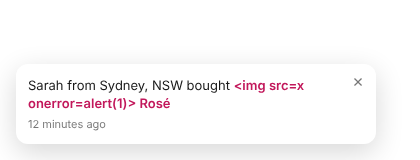

# FomoPulse

**Open-source social proof notifications for Shopify.** Show shoppers real, recent activity from your store, such as *“Sarah from Sydney, NSW bought Lyre's Spritz · 12 minutes ago”* or *“14 people bought this in the last 24 hours”*. No monthly fee, and you own the data.



> FomoPulse is an independent open-source project. It is not affiliated with, endorsed by or connected to Fomo or any other social proof vendor.

## Features

- **Recent purchase popups** built from real orders (`orders/create` webhook)
- **Best-seller roundups**, e.g. “12 people bought X in the last 24 hours”
- **Import recent orders** with one click so the widget has content straight after install
- **Privacy first:** stores only first name, city/state and product. No emails, surnames, addresses or order values. All data is deleted on uninstall, and the GDPR webhooks are handled
- **Merchant controls:** position, light/dark theme, accent colour, timing, max per page, excluded pages, name style (Sarah / S. / Someone), message templates
- **Fast, safe storefront script:** about 12 KB uncompressed, no dependencies, loads with `defer`, renders text with `textContent` (XSS-safe), same-origin links only
- **Accessible:** polite `aria-live` announcements, keyboard focusable, close button, respects `prefers-reduced-motion`, and pauses on hover, focus or a hidden tab
- **Attribution:** UTM tags on every link, plus a `_fomopulse_click` cart attribute so orders show which shoppers clicked a notification
- **Theme app extension:** merchants switch it on in the theme editor with no theme code edits

## How it works

```
Shopify order ──(orders/create webhook)──► FomoPulse app ──► database (anonymised events)
                                                  │
Storefront ◄──(App Proxy: /apps/fomopulse/feed)───┘  messages pre-rendered server-side, cached 60s
   │
   └── fomopulse.js (app embed): delay ▸ show ▸ hide ▸ gap ▸ next … up to N per page
```

| Part | Path |
|---|---|
| Order → event mapping (privacy rules) | `app/lib/order-mapper.ts` |
| Feed builder (templates, roundups, interleaving) | `app/lib/feed.ts` |
| Settings schema + validation | `app/lib/settings.ts` |
| Public feed (App Proxy) | `app/routes/proxy.feed.tsx` |
| Webhooks (orders, uninstall, GDPR) | `app/routes/webhooks.*.tsx` |
| Admin pages | `app/routes/app._index.tsx`, `app/routes/app.settings.tsx` |
| Storefront widget | `extensions/fomopulse-embed/` |

Built on the official [Shopify React Router app template](https://github.com/Shopify/shopify-app-template-react-router), using Prisma and Polaris web components.

## Quick start (development)

**Requirements:** Node.js 22.12+, a [Shopify Partner account](https://partners.shopify.com/signup) and a [development store](https://help.shopify.com/en/partners/dashboard/development-stores).

```bash
git clone https://github.com/lokeshshingh/fomopulse.git
cd fomopulse
npm install
npm run dev            # runs `shopify app dev`; log in, create/link an app, pick your dev store
```

Then:

1. Press **P** in the terminal to open the app and install it on your dev store.
2. In the app, click **Open theme editor** and switch on the **FomoPulse** app embed, then save.
3. Place a test order, or click **Import recent orders**. Set `FOMOPULSE_INCLUDE_TEST_ORDERS=true` to include test orders.
4. Visit your storefront. Notifications start after the configured delay.

## Deploying to production

Any Node host works: Fly.io, Render, Railway, Heroku, a VPS, or Docker (a `Dockerfile` is included).

1. **Database:** SQLite is fine for development. For production, switch `provider` in `prisma/schema.prisma` to `postgresql` (or `mysql`) and set `url = env("DATABASE_URL")`. Then regenerate the migrations with `npx prisma migrate dev`.
2. **Environment variables:** see `.env.example` (`SHOPIFY_API_KEY`, `SHOPIFY_API_SECRET`, `SHOPIFY_APP_URL`, `SCOPES`).
3. **Push the app config and extension:** `npm run deploy`.
4. **Start:** `npm run docker-start` (runs migrations, then starts the server).

See Shopify's [deployment guide](https://shopify.dev/docs/apps/launch/deployment) for host-specific steps.

## Customer names and locations (important)

Shopify treats names and addresses as **protected customer data**. Until your app is approved for those fields:

- webhook payloads arrive with names and addresses redacted, and
- notifications automatically fall back to the anonymous label (“Someone bought …”).

To show first names and cities, request access under **Partner Dashboard → App → API access → Protected customer data**. You need *Name* and *Address* at level 2. [Read the requirements.](https://shopify.dev/docs/apps/launch/protected-customer-data)

## Configuration

Everything is set in the app's **Settings** page:

| Setting | Default |
|---|---|
| Position / theme / accent colour | bottom-left · light · `#111111` |
| Delay before first · show for · gap | 4 s · 8 s · 12 s (randomised ±40%) |
| Max notifications per page | 5 |
| Purchases from the last | 72 hours |
| Name style | First name (falls back to “Someone”) |
| Purchase message | `{{name}} from {{location}} bought {{product}}` |
| Roundup message | `{{count}} people bought {{product}} in the last {{window}}` |
| Roundup minimum / window | 3 orders · 24 hours |
| Excluded pages | `/cart`, `/checkouts`, `/account` |

Server environment options: `FOMOPULSE_INCLUDE_TEST_ORDERS`, `FOMOPULSE_RETENTION_DAYS` (default 30).

### Storefront JavaScript API

```js
window.FomoPulse.pause(); // pause the rotation
window.FomoPulse.stop();  // remove notifications for this page view
window.FomoPulse.next();  // show the next notification now
```

Clicking **×** snoozes notifications for that shopper for 24 hours.

## Responsible use

FomoPulse is built for **honest** social proof. It only shows events that really happened. Please don't modify it to invent purchases. Fake activity can breach consumer law, such as the Australian Consumer Law, the FTC Act and EU UCPD, as well as Shopify's Partner Program Agreement.

Selling alcohol? Keep messages factual (no quantities, no urgency) to stay within local alcohol advertising codes, such as ABAC in Australia.

## Testing

```bash
npm test          # unit tests (vitest): privacy mapping, feed building, settings validation
npm run lint
npm run typecheck
```

## Contributing

PRs welcome. See [CONTRIBUTING.md](CONTRIBUTING.md). Ideas on the roadmap:

- [ ] Product-page inline badge (“23 sold in the last 24 hours”)
- [ ] Low-stock notifications
- [ ] Review notifications (Judge.me / Yotpo)
- [ ] Klaviyo event on notification click
- [ ] Translations for the default message templates
- [ ] Per-market templates

## License

[MIT](LICENSE). Free for personal and commercial use.
